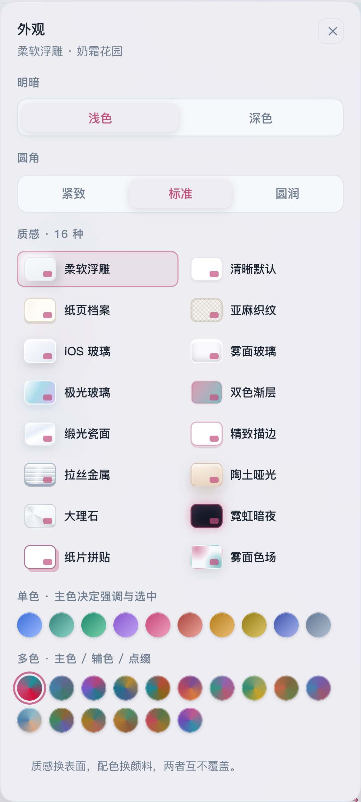
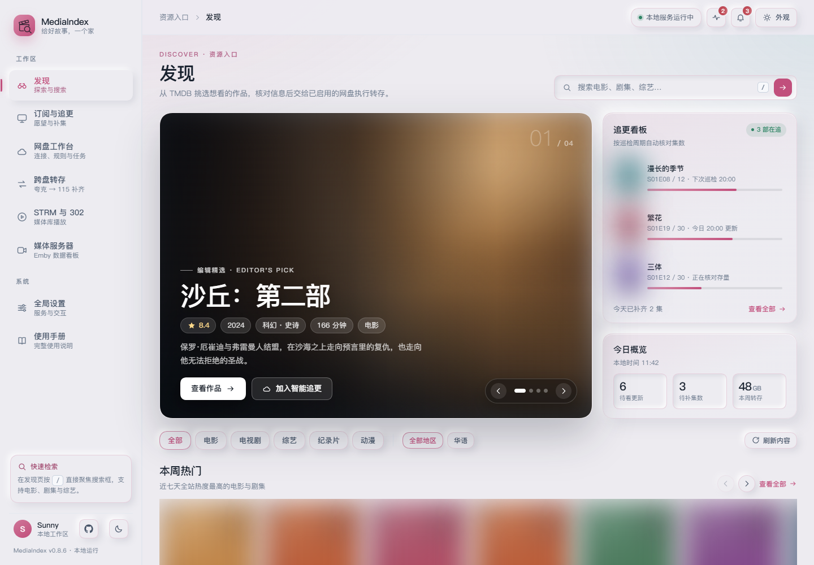
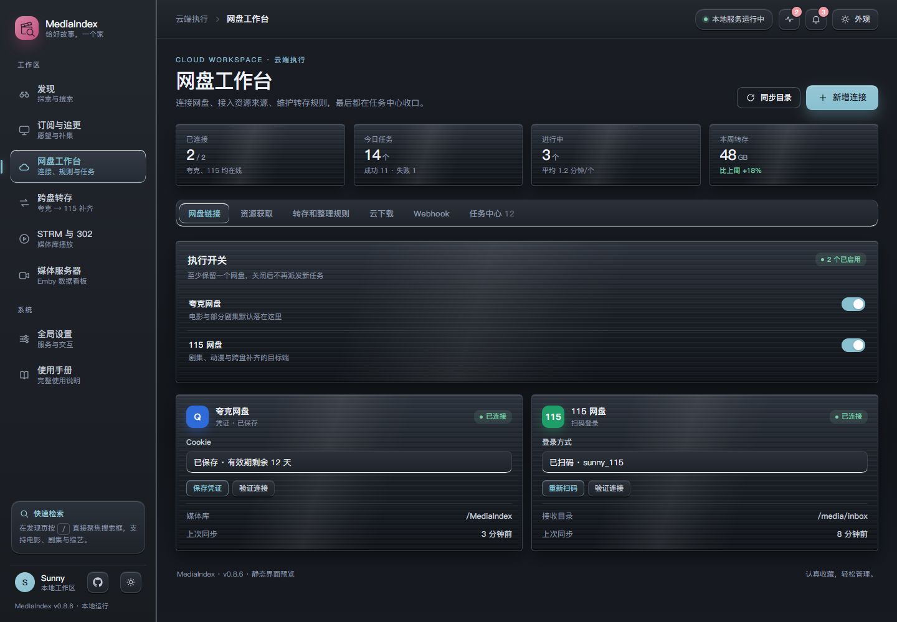
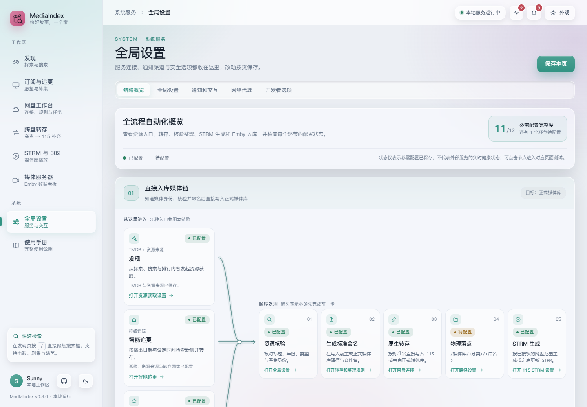

# Sunny UI · 2.0.0

**以 MediaIndex 新设计稿为唯一视觉基准的设计系统。** 旧设计规范与外观样式已弃用。16 种质感、10 个单色、16 组多色、浅深模式和 3 档圆角，全部来自用户指定的 `MediaIndex-UI-Preview/index.html`。

[设计规范](skills/sunny-ui-design/references/design-standard.md) · [接入说明](skills/sunny-ui-design/references/integration.md) · [AI 设计 Skill](skills/sunny-ui-design/SKILL.md) · [验证记录](docs/2.0.0-validation.md) · [版本变化](CHANGELOG.md)

[下载 v2.0.0 安装包](https://github.com/xudong7587/sunny-ui-design-system/releases/download/v2.0.0/xudong7587-sunny-ui-design-system-2.0.0.tgz) · [下载 v2.0.0 设计 Skill](https://github.com/xudong7587/sunny-ui-design-system/releases/download/v2.0.0/sunny-ui-design-skill-2.0.0.zip)

## 新设计规范

| 维度 | 设计稿中的规则 |
| --- | --- |
| 明暗 | light / dark，独立保存；背景、文字、状态色与光影各有定义 |
| 材质 | 页面环境、侧栏、顶栏、面板、控件、输入与选中态共同变化 |
| 配色 | 主色、辅色、点缀分别参与操作、环境光和装饰；单色也保留设计稿的辅助色 |
| 圆角 | tight / default / round，系数 0.42 / 1 / 1.9，按各组件原始公式应用 |

浮雕采用连续基底与凹凸光影；玻璃区分清透、雾面与极光；金属保留拉丝和硬高光；纸张、织物、陶土、石材分别拥有自身的纹理。**不再用旧版“外层凸起、内层必须凹陷”等统一规则覆盖设计稿。** 内层卡片与输入按各自原始样式呈现。

页面以稳定外壳、标题与主操作、概览指标、分区导航、内容模块组成。面板标题内边距统一，同排卡片拉伸等高。任务详情按分组展开；窄屏改为抽屉导航与单列内容，表格在容器内滚动。

## MediaIndex 新设计截图

下图是指定 HTML 在浏览器中的实际静态预览，展示宿主布局，并非组件库自带的业务功能。海报、主视觉画面及缩略图区域（包括占位海报）已做 **24px 高斯模糊**；原始设计文件未修改，只保存处理后的截图。

### 外观面板 · 16 种材质

从新版设计稿直接截取弹出的外观面板，完整展示明暗、圆角、16 种材质和全部配色色盘。截图以 3 倍像素密度保存，尺寸为 1080 × 2395；画面中不含影视海报。

<a href="docs/images/mediaindex-2.0-appearance-hd.png"></a>

### 柔软浮雕 × 奶霜花园 · 发现



### 拉丝金属 × 北境极光 · 工作台



### iOS 玻璃 × 马卡龙 · 全局设置



截图参数见 [记录](docs/images/mediaindex-2.0-captures.json)。重拍脚本为 `docs/capture-preview.cjs`，需可加载的 Playwright 和本机 Edge，传入原 HTML 路径即可。

## 完整预设

| 类别 | 选项 |
| --- | --- |
| 材质 16 | 柔软浮雕、清晰默认、纸页档案、亚麻织纹、iOS 玻璃、雾面玻璃、极光玻璃、双色渐层、缎光瓷面、精致描边、拉丝金属、陶土哑光、大理石、霓虹暗夜、纸片拼贴、雾面色场 |
| 单色 10 | 晴蓝、青瓷、松绿、鸢紫、莓红、砖窑、琥珀、芥末、靛蓝、石墨 |
| 多色 16 | 奶霜花园、北境极光、鸢尾暮色、深海鎏金、海盐日落、暮色熔岩、马卡龙、薄荷雪松、蜜桃乌龙、蓝调花雾、海雾晨光、雨后花园、蜂蜜麦田、沙漠绿洲、红茶玫瑰、紫罗兰夜 |

## 运行与接入

```sh
pnpm install --frozen-lockfile
pnpm dev
pnpm typecheck
pnpm build
```

打开终端给出的本地地址，在右上角“外观”切换四个维度。`pnpm build` 生成 ESM 库、类型及独立演示网站；`pnpm preview` 预览构建，`pnpm pack` 可创建本地安装包。GitHub Release 提供安装包和设计 Skill；此包尚未发布到 npm。

复制 `skills/sunny-ui-design/assets/appearance/` 整个目录，或使用构建包：

```tsx
import { AppearancePicker, configureAppearance, useAppearanceTheme } from "./appearance/AppearancePicker";
import "./appearance/appearance.css";
configureAppearance({ storagePrefix: "my-app" });
function Toolbar() {
  const [theme, setTheme] = useAppearanceTheme();
  return <AppearancePicker theme={theme} onThemeChange={() => setTheme(theme === "light" ? "dark" : "light")} />;
}
```

2.0 使用设计稿原始类名 `.panel`、`.entry-card`、`.input`、`.btn`、`.sidebar` 等；旧版 `.appearance-surface` 和 `--material-*` 不再定义。完整迁移映射见 [接入说明](skills/sunny-ui-design/references/integration.md)。原始 CSS 为全站样式，接入时需审查宿主类名冲突。

## 唯一设计来源

`preview.css` 是指定 HTML 的完整 style 内容，逐字提取，`presets.ts` 是其中的材质、配色与圆角目录。React 只负责选择、保存、同步与弹层开关，不另造视觉规则。

[来源指纹](docs/design-source.json) 记录输入与 CSS 的 SHA-256。更新已确认设计稿后运行：

```sh
node docs/import-preview.cjs /path/to/MediaIndex-UI-Preview/index.html
```

## 交给 AI

```text
请按 Sunny UI 2.0 完成当前界面。
先读取 AGENTS.md、skills/sunny-ui-design/SKILL.md 及其设计规范与接入说明。
唯一视觉基准是 assets/appearance/preview.css 和 presets.ts，源于指定 MediaIndex 预览 HTML。
不要引用或恢复 Sunny UI 1.x 的配色、材质、字体、圆角与布局规则。
保留当前业务功能，使用设计稿的组件样式，检查桌面、窄屏、外观持久化和键盘操作。
```

代码使用 GPL-3.0-only，详见 [来源与许可](docs/sources.md)。
