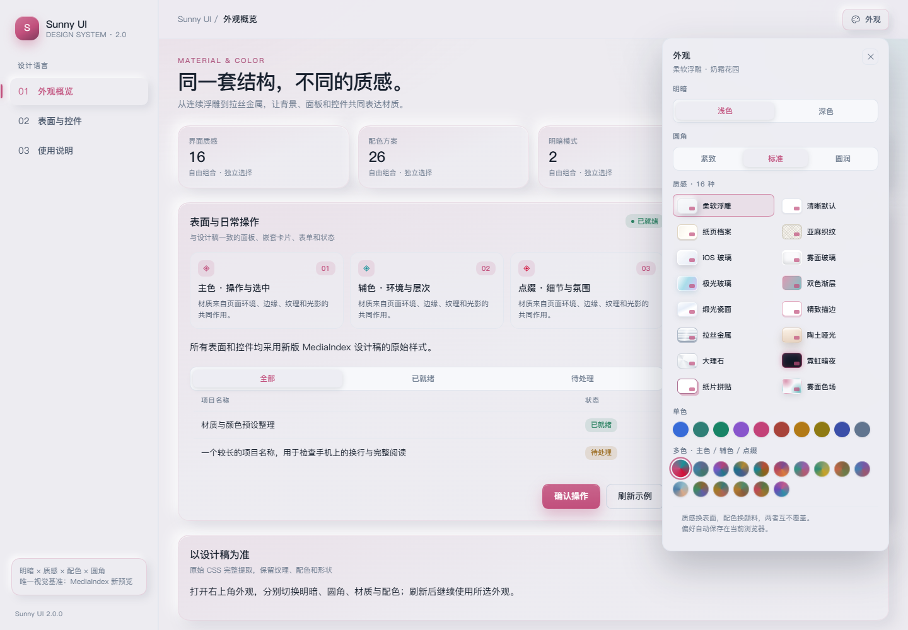
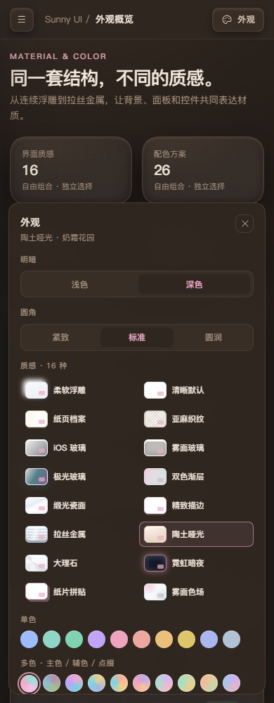

# Sunny UI 2.0.0 验证记录

日期：2026-10-21。运行环境：本机 Edge 无头浏览器、Vite 开发服务、1440×1000 桌面及指定窄屏。视觉基准只使用用户指定的 MediaIndex-UI-Preview/index.html。

## 已完成

- `pnpm install --frozen-lockfile`、`pnpm typecheck`、`pnpm build` 通过；生成 ESM 库、类型和演示网站。
- 原 HTML style 内容与 preview.css 逐字相同，SHA-256 记录在 design-source.json 与 2.0.0-checks.json。
- 2 明暗 × 16 材质 × 26 配色 × 3 圆角，共 **2496 组合**：比较原稿与库中 panel、input、btn primary、entry-card、body 的 backgroundColor/backgroundImage/color/borderTopColor/borderTopLeftRadius/boxShadow/backdropFilter/fontFamily，全部一致。
- 外观 UI 实际选择材质、颜色、圆角和明暗，四维独立；刷新保留，跨标签切换同步。
- Esc 收起原生外观 popover；业务确认 dialog 可打开和 Esc 关闭。
- 320、390、700、1440px 页面无横向溢出，外观面板边界位于视口内。
- 旧 default 材质回退 clear，未知圆角回退 default。
- 页面没有未捕获 JavaScript 错误。
- 检视桌面浅色与手机深色截图，待过渡动画完成后保存，文字与浮层清楚。
- README 三张 MediaIndex 截图的主视觉、海报及缩略图已使用 CSS blur(24px) 高斯核模糊；未改原 HTML，未保存未处理截图。

机器结果见 [2.0.0-checks.json](2.0.0-checks.json)，可复现检查脚本为 verify-design.cjs。脚本需可加载 Playwright、本机 Edge、5198 端口的演示服务，以及原 HTML 路径。

## 库演示截图

与 README 的宿主预览分开记录；这些是本仓库 React 组件运行结果。

## 边界

2496 组合是计算样式一致性检查，不代表每种组合、每个业务页面都人工审美或对比度验收。原稿中的局部特例、色盘元数据与 CSS 微小差异均保留，未自行套入旧版纠正规则。未验证全部浏览器，也未认证完整无障碍合规。没有改动 MediaIndex 的实际工程或后端。
